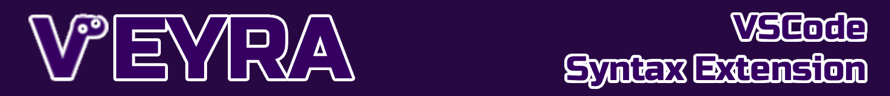

<div align="center">

</div>

Syntax highlighting, auto-indentation, code folding, and snippet support for the Veyra programming language.

## Features

- Syntax highlighting (`.vey` files)
- Comment support using `#`
- Automatic bracket and quote closing
- Block folding (`if`, `repeat`, `add`)
- Built-in snippets: `if`, `ife`, `ifee`, `repeat`, `rwhile`, `add`, `func`, `set`, `say`, `get`

## Installation

Extension should be already packed at [veyra-0.1.0.vsix](veyra-0.1.0.vsix). If you want to modify the extension and install it follow these steps:

```bash
cd veyra-vscode
npm install -g @vscode/vsce
vsce package

# You can install the packed extension with this command:
code --install-extension veyra-0.1.0.vsix

# You can also install it from VSCode:
#  - Go to `Extensions`,
#  - Click on three dots right next to search bar,
#  - Click on `Install from VSIX...`,
#  - Choose the extension you packed,
#  - VSCode will install and restart your extension in a short time.
```
